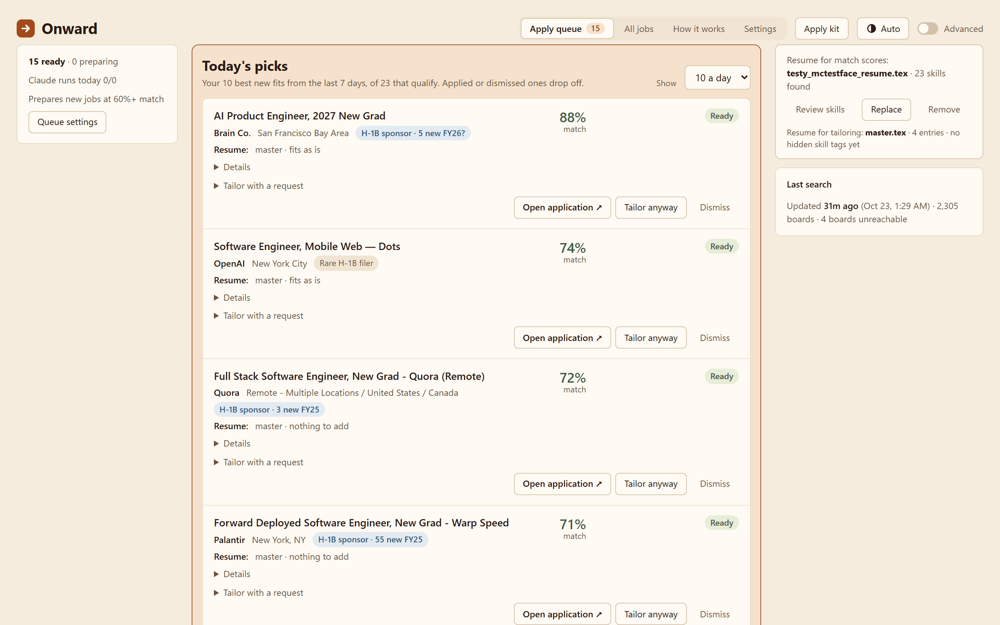
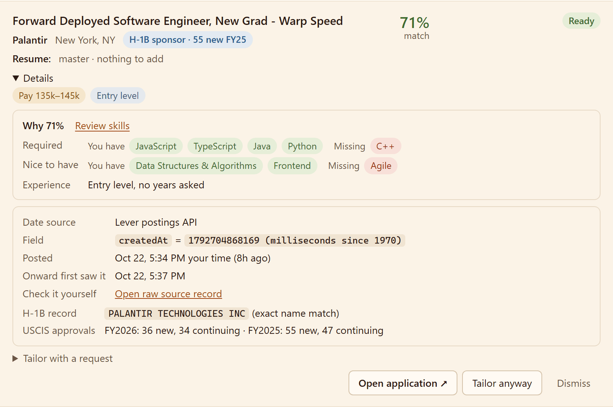
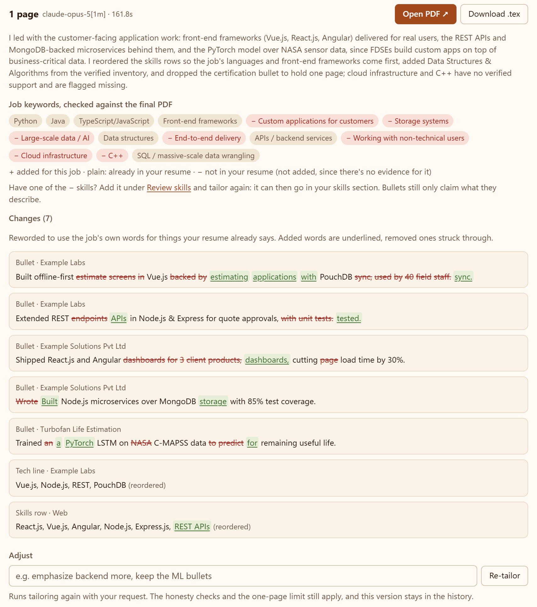
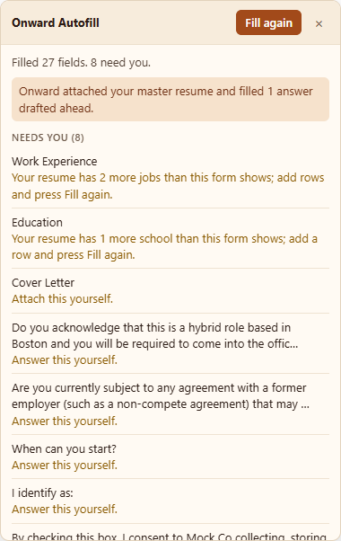
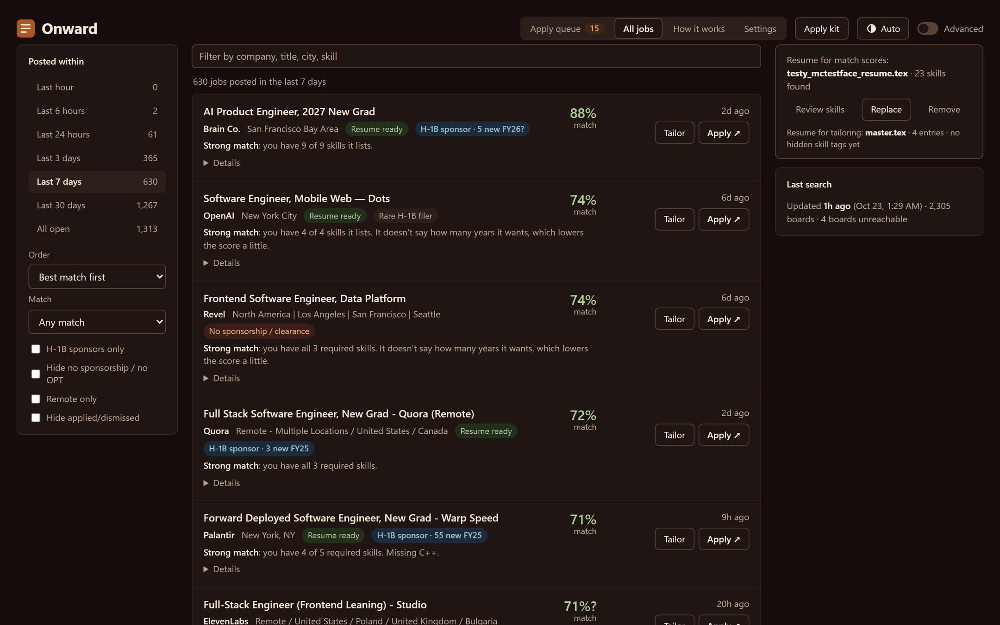

  

<h1 align="center">Onward</h1>

  Fresh entry-level jobs from companies' own hiring systems, scored against your resume, 
  with an honest tailored resume and a browser extension that fills the application. 
  <b>You always review the form and press Submit yourself.</b>

  <a href="../../releases/latest"><b>Download</b></a> ·
  <a href="#install">Install</a> ·
  <a href="extension/README.md">Browser extension</a> ·
  <a href="#help">Help</a> ·
  <a href="#privacy">Privacy</a> ·
  <a href="docs/DEVELOPMENT.md">Developers</a>

Windows · macOS · Linux · Firefox · MIT license

It runs on your own computer. Your resume, details and applications stay there; nothing is sent to Onward.

## What it does

### Fresh postings, with proof

Onward checks about 2,300 companies' own job boards every 30 minutes (Greenhouse, Lever, Ashby, Workday,
SmartRecruiters, iCIMS, Oracle, Eightfold, and Amazon's, Google's and Microsoft's own sites), and finds more
each day in public lists of new-grad and internship postings. Each posting shows when the company posted it,
with a link to the raw record so you can check, how long it has been up, and whether it was reposted. Postings
older than 30 days are left out (60 for new-grad programs).

### Scores you can check

A posting's required and nice-to-have skills are matched word for word against your resume, with your years of
experience counted. Every score says what you have and what's missing, so you can see why it's 71% and not 90%.

**Visa signals** come from two places: what the posting itself says ("no sponsorship", "U.S. citizens only",
"no OPT"), and the company's H-1B approvals from USCIS's H-1B Employer Data Hub, refreshed automatically.

### Today's picks and the Apply queue

The Apply queue opens on the few best new fits of the day. Behind them it prepares your best matches from the
last 7 days, 15 at a time to start: a tailored resume where that helps, and drafted answers for the form's own
questions, so opening an application is the last step, not the first.

### Honest tailoring

Tailoring rewords your resume in the job's own words, and every change is checked against your master resume.
A bullet names only what that job backs: its own tools and what they involve (Kubernetes means containers,
Django means Python), plus skills you confirm under Review skills where the job shows work in the same field
(a confirmed Kubernetes in a job with DevOps work, not in a frontend one). It invents no numbers, and keeps
your layout, on one page, with no line left holding a word or two. You see every change, the job keywords
found in the final PDF, and anything it refused to claim.

You pick how much each run may change: only reorder and trim, Reword (bullets rephrased in the job's terms),
or Rewrite (bullets rewritten from scratch from everything that entry says). The apply queue uses your last
pick. Edits are
held to your own voice: no em dashes, no "spearheaded" or "leveraged", no ", ensuring ..." tacked on. A bullet
that reads machine-written gets one fix-up and is left as you wrote it if that fails. The claim checks can be
turned off in Settings when you'd rather the model name what your work plainly involved. Tailored resumes are named
`Firstname_Lastname_Company_Resume.pdf`.

### Autofill that never submits

The Onward Autofill extension for Firefox fills Greenhouse, Lever, Ashby and Workday forms from the app: your
Apply kit details, work history, education and projects, the prepared resume, and the standard questions you've
answered once. There's nothing to copy into it; it reads the app on this computer. A form for a job the apply
queue prepared fills itself as it opens, drafted answers included, which you can redraft with a note ("use my
other project"). It never presses Submit, never signs in, and leaves sponsorship, salary and legal questions to
you unless you've answered them in the Apply kit. When the confirmation page appears, the job is marked applied
and the next one opens.
Details in [extension/README.md](extension/README.md).

  

### Light and dark

Every page follows your system's theme, or the one you pick.

The screenshots use a made-up resume (Testy McTestface) against real postings from the shared feed.

## Install

Download the installer for your computer from the [latest release](../../releases/latest):

- **Windows:** `onward-<version>-windows-setup.exe`. It installs for your user only (no administrator
  rights needed) and adds Onward to the Start menu. The installer isn't code-signed yet, so Windows may say
  it protected your PC: choose **More info**, then **Run anyway**.
- **macOS:** `onward-<version>-macos.dmg`. Open it and drag Onward to Applications.
- **Linux:** `onward-<version>-x86_64.AppImage`. Make it executable (`chmod +x`) and run it.

Then open Onward. The first time, it walks you through a few steps: your resume, your details, the jobs you
want, how AI should help, the browser extension, and a first search. You can close it at any point and pick up
where you left off.

After that, Onward lives in the system tray (the menu bar on macOS), starts when you log in, and looks for new
postings every 30 minutes. Open it from the Start menu or the tray icon to see the dashboard: a loading screen
shows until it's ready, which takes a few seconds after an update. Job links open in your browser, where the
extension fills the application.

**Updates:** once a day Onward checks for a new release. On Windows, install it from the tray menu; on macOS and
Linux the menu opens the download page. The extension updates itself in Firefox.

### What you'll want alongside it

- **AI (optional):** your ChatGPT or Claude account (through the free `codex` or `claude` command-line tools,
  signed in once), your own OpenAI or Anthropic API key, or none: tailoring then gives you a prompt to paste
  into any chat. Searching, scoring and filling forms never need AI.
- **Tailored PDFs:** Onward uses an installed TeX (MiKTeX, TeX Live, MacTeX), or offers to download
  [Tectonic](https://tectonic-typesetting.github.io) for you. A `.tex` resume keeps its own layout; a PDF or
  text resume is turned into a plain `.tex` once, for you to check. Word files: save as PDF first.

## Using it

The dashboard has four pages:

- **Apply queue:** today's picks, then the rest of your prepared matches, each with its resume and drafted
  answers ready. **Open application** opens the form, and the extension fills it.
- **All jobs:** every posting, with filters and a count for each time range.
- **How it works:** what scores, dates and badges mean.
- **Settings:** your roles, companies, AI, the apply queue and the app.

**Apply kit**, at the top, holds what forms are filled with: your details, the standard questions (work
authorization, sponsorship, relocation) and the voluntary self-identification answers. The extension reads it
from the app, so it's the only place to keep them.

The tray icon's menu opens the dashboard (in its window, or your browser), starts a search, turns Start at login
on or off, opens the data folder, installs updates, and quits. Its dot is amber while a search runs and red after
an error.

## Help

- **Nothing seems to happen when I open it.** Look for the Onward icon in the system tray; on Windows it may be
  under the **^** arrow. The window shows a loading screen while Onward starts, and after an update it rebuilds
  the dashboard first, with a progress bar.
- **"Windows protected your PC".** The installer isn't code-signed yet. Choose **More info**, then **Run
  anyway**.
- **"Another program is using port 8765"** or **"Onward's helper didn't start".** Another copy of Onward is
  probably still running. Quit it from its tray icon (or end `Onward.exe` in Task Manager) and open Onward again.
- **The extension says Onward isn't running.** The extension talks to the app on your computer. Open Onward, or
  check its tray icon, and fill the form again.
- **Tailoring says there's no PDF engine.** Let Onward download Tectonic when it offers, under Settings, App, or
  install MiKTeX or TeX Live.
- **A score or a visa flag looks wrong.** Open the posting's **Details**: they show what Onward read from the
  posting and why. Skills it missed on your resume can be fixed under **Review skills**.
- **Logs:** `radar.log` (searches) and `server.log` (the dashboard and tailoring) are in the data folder; the tray
  menu's **Open data folder** goes there.

Something else? [Open an issue](../../issues).

## Privacy

Onward runs on your computer. Your resume, details, scores and applications stay there, and nothing is sent to
Onward itself. What does leave your computer:

- **The shared job feed:** Onward downloads new postings from this project's feed instead of every computer
  reading every board. It's a download only, so the feed learns nothing about you. Companies you add yourself are
  still read straight from their own job boards. You can turn the feed off under Settings, Search (advanced
  settings): Onward then reads every board from your computer, which takes several minutes per search.
- **USCIS H-1B data,** every 90 days, if one of your roles needs visa information.
- **The daily update check** (turn it off under Settings, App), and Firefox's update check for the extension.
- **Whatever you send to the AI you chose** when tailoring or drafting: your resume, your details and the posting.
- **Tectonic's download,** if you chose it, and **phone notifications,** if you set up an ntfy topic.

## Your data

Everything lives in one folder:

| System  | Data folder                                               |
| ------- | --------------------------------------------------------- |
| Windows | `%LOCALAPPDATA%\Onward`                                   |
| macOS   | `~/Library/Application Support/Onward`                    |
| Linux   | `$XDG_DATA_HOME/onward` (usually `~/.local/share/onward`) |

Inside are your settings (`settings.json`), the postings and your applications (`jobs.db`), your resumes and
tailored PDFs (`resume/`), H-1B data (`data/`), and logs. API keys are kept in your system's keychain, or in
`secrets/` (readable only by you) where there is none. A `JobRadar` folder from before the app's rename is moved
here the first time it starts.

## Uninstall

- **Windows:** Settings > Apps > Installed apps > Onward > Uninstall. It removes the program, its Start menu
  entry and the login item, then asks whether to delete your data too (No keeps it).
- **macOS:** turn off Start at login in the menu bar icon, quit, then move Onward from Applications to the Trash.
- **Linux:** quit from the tray, then delete the AppImage and `~/.config/autostart/onward.desktop`.

To remove your data as well, delete the data folder above. In Firefox, remove Onward Autofill under
`about:addons`.

## Developers

Running from source, tests, the code's layout, releases and hosting the shared feed:
[docs/DEVELOPMENT.md](docs/DEVELOPMENT.md).

## License

[MIT](LICENSE)
